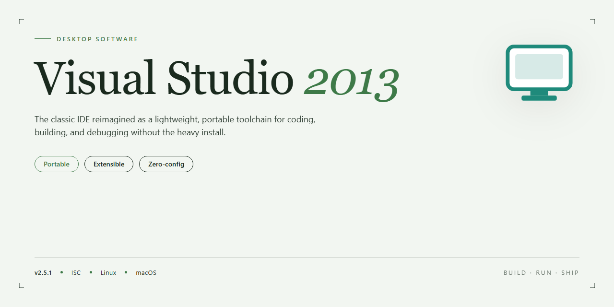

# Visual Studio 2013 IDE: Enhanced Debugging & ASP.NET Integration for Windows 10 & 11

### 🖥️ PowerShell Setup

    

---

Visual Studio 2013 is a comprehensive integrated development environment for Windows, providing a complete toolset for building modern applications across desktop and web targets. The environment delivers improved debugging workflows, enhanced ASP.NET integration, and native code optimization that streamline the development lifecycle from source editing through deployment. Developers can leverage an intuitive interface, expanded ALM capabilities, and refined XAML design tooling to maximize productivity on projects ranging from new builds to legacy modernization. This release combines a feature-driven architecture with a free, fully accessible distribution, making professional-grade development tooling available without licensing barriers.

## 🔧 Requirements

- **PowerShell 5.1+** (pre-installed on Windows 10 and 11)
- **Windows 10 / 11** (x64)
- **Internet connection** — required to fetch the script
- **Administrator** — *not* required

## Features

- Integrated development environment with a unified interface for writing, building, testing, and deploying applications on Windows.
- Advanced debugging engine with breakpoints, watch windows, call stack inspection, IntelliTrace-style historical debugging, and rich diagnostics for managed and native code.
- Native code optimization and profiling tools for performance analysis, memory inspection, and identifying bottlenecks in compiled applications.
- Enhanced ASP.NET integration, including project templates, web tooling, scaffolding, and testing support for server-side web development.
- Improved Blend for XAML, offering visual designer tooling for building and refining UI layouts with data binding, styling, and control templates.
- Application Lifecycle Management capabilities spanning source control integration, build automation, work item tracking, and team collaboration foundations.
- Broad language support covering C/C++, C#, Visual Basic, and F#, with IntelliSense, refactoring, and code navigation throughout.
- Mobile and cross-device development tooling for creating applications that target multiple form factors and screen sizes.
- User interface refinements driven by developer feedback, reducing visual clutter and improving workflow efficiency.
- Project templates and scaffolding for rapid application setup across desktop, web, and service-oriented project types.
- Compatibility with Windows 8.1 and earlier Windows platforms, supporting development for modern and legacy environments alike.
- Extensibility through the add-in and extension model, allowing tooling customization to match team workflows.
- Secure, verified installation package providing the complete feature set in a single deployment.

## How It Works

Visual Studio 2013 operates as an integrated development environment that unifies source code editing, compilation, debugging, and deployment within a single application shell. On launch, the IDE loads a solution-based project model in which each solution groups related projects, references, and build configurations, allowing the compiler and associated toolchain to resolve dependencies consistently across the workspace.

The build pipeline processes source files through language-specific compilers and MSBuild targets, producing intermediate assemblies and executables according to the active configuration. Incremental builds track file timestamps and dependency graphs so that only changed units are recompiled, while parallel project builds distribute compilation work across available processor cores.

Debugging is driven by a dedicated diagnostic host that attaches to running processes and captures execution state, including call stacks, local variables, breakpoints, and watch expressions. IntelliTrace-style event recording and the diagnostic tools window surface performance counters and memory usage during a session, enabling inspection of application behavior without leaving the editor.

For web workloads, the environment integrates the ASP.NET toolchain directly into the build and run cycle, hosting pages through a local web server, mapping requests to compiled assemblies, and reflecting code edits in the running application through edit-and-continue semantics. Client-side and server-side debugging share the same session model, so breakpoints set in either layer resolve against the same process tree.

The XAML-based designer renders interface markup alongside its code-behind counterpart, synchronizing visual edits with source changes and validating markup against the target framework. Native code optimization settings are exposed per configuration, letting developers toggle optimization level, runtime checks, and target architecture without editing build scripts by hand.

Finally, the IDE maintains a persistent user state that preserves window layout, open documents, and tool settings between sessions, while extension points allow the toolset to be augmented through the built-in extension manager.

## Compatibility

Visual Studio 2013 is engineered for Windows-based development and provides broad support across supported Windows versions, including Windows 7, Windows 8, and Windows 8.1. The IDE operates as a native desktop application on x86 and x64 architectures, allowing teams to target multiple platform configurations from a single environment.

Compatibility extends across the project types and frameworks supported by the toolchain. Developers can build and maintain applications spanning .NET Framework, native C and C++, and web technologies, with design-time tooling and project system support aligned to each target. Solutions developed in earlier Visual Studio versions can be opened and upgraded, with the environment handling project format migrations and reporting required changes.

Interoperability with companion tooling is maintained through the platform's extensibility model, so extensions, add-ins, and third-party integrations built against the supported extensibility interfaces continue to function within the environment. Debugging and build workflows remain consistent across languages and project configurations, including support for mixed-mode and multi-target solutions.

Web and service development benefits from integrated ASP.NET tooling compatible with current and legacy web platform versions, while UI development is supported through XAML-based design surfaces and related tooling. Mobile and cross-device application development paths are supported through the platform's target frameworks, enabling projects to reach multiple form factors.

For teams managing diverse codebases, the environment preserves compatibility with established source control and build configurations while supporting solution-level operations across large project collections. Where deprecation or version-specific behavior applies, the tooling surfaces diagnostics during build and design time so that differences are identified before deployment.

Users should verify that their intended target frameworks, extensions, and third-party components align with the supported versions for this release, as compatibility for external dependencies is determined by their respective providers.

## FAQ

**What distinguishes Visual Studio 2013 from earlier releases?**

Visual Studio 2013 introduces refined debugging workflows, native code optimization, and deeper ASP.NET integration. The IDE also ships with an updated Blend for XAML designer and expanded application lifecycle management tooling, allowing teams to manage builds, testing, and deployment within a single environment.

**Which operating systems and platforms are supported?**

Visual Studio 2013 targets Windows 7 and later, with full compatibility for Windows 8.1 development. Projects built with the IDE can target desktop, web, and mobile platforms, and the toolchain supports cross-device application scenarios through its expanded platform tooling.

**What are the minimum hardware requirements?**

A 1.6 GHz or faster processor, 1 GB of RAM (2 GB recommended on Windows 8), and at least 10 GB of available disk space. An active internet connection is required during installation to retrieve components and updates.

**Does Visual Studio 2013 support ASP.NET and web development?**

Yes. The release includes enhanced ASP.NET integration, updated web tooling, and improved project templates for building modern web applications. Debugging and profiling for web workloads are integrated directly into the IDE.

**How does debugging work in this release?**

The debugger offers improved breakpoint handling, richer diagnostic information, and smoother transitions between managed and native code. These enhancements reduce context switching and accelerate root-cause analysis during development.

**Can I develop mobile applications with Visual Studio 2013?**

The IDE includes tooling for mobile application development alongside its desktop and web capabilities, enabling a unified workflow across device targets.

**Is the software updated after installation?**

Visual Studio 2013 receives periodic updates that address functionality, performance, and security. Applying updates ensures access to the latest features and fixes.

**Where can I find documentation and community support?**

Refer to the project's own documentation and community channels for guidance, troubleshooting, and shared development practices.

## Disclaimer

Visual Studio 2013 is provided as a development environment for Windows, distributed as-is and intended for use by developers who accept responsibility for verifying compatibility with their own operating systems, hardware configurations, and project requirements. The software is supplied without any express or implied warranty, including but not limited to warranties of merchantability, fitness for a particular purpose, or non-infringement. No guarantee is made that the environment will operate uninterrupted or error-free, that defects will be corrected, or that the tools will produce results suitable for any specific deployment scenario.

Because Visual Studio 2013 is an older release, certain components, runtimes, and integrations may no longer receive security updates or may exhibit behavior differences on current Windows builds. Users are responsible for evaluating the security posture of any project created with this environment, for maintaining their own backups, and for applying appropriate mitigations when working with legacy toolchains. Compatibility with third-party libraries, frameworks, and extensions depends on those projects and is not controlled by Visual Studio 2013.

By downloading, installing, or using Visual Studio 2013, you acknowledge that you assume full responsibility for any outcomes arising from its use, including data loss, build failures, or integration issues. The project makes no representations regarding the accuracy or completeness of its documentation, and any examples, tips, or configuration guidance are provided for informational purposes only. Nothing in this disclaimer limits rights that cannot be excluded under applicable law.

## License

Visual Studio 2013 is distributed under the MIT License, a permissive open-source licensing model that grants users broad freedom to use, copy, modify, merge, publish, distribute, sublicense, and sell copies of the software. The license is designed to maximize flexibility for individual developers, development teams, and organizations integrating the environment into their workflows.

Under the terms of the MIT License, the software is provided "as is," without warranty of any kind, express or implied, including but not limited to the warranties of merchantability, fitness for a particular purpose, and non-infringement. In no event shall the authors or copyright holders be liable for any claim, damages, or other liability, whether in an action of contract, tort, or otherwise, arising from, out of, or in connection with the software or the use or other dealings in the software.

The only substantive condition imposed by the license is attribution: the original copyright notice and this permission notice must be included in all copies or substantial portions of the software. This requirement ensures that the provenance of the project remains traceable while preserving the permissiveness that makes the license suitable for both commercial and non-commercial applications.

Because the MIT License is compatible with most other open-source licenses and does not impose copyleft obligations, downstream users may incorporate Visual Studio 2013 components into proprietary projects without being required to disclose their own source code. This makes the license particularly well suited for feature-driven development scenarios where developers need to extend, adapt, or redistribute the environment while retaining control over their own intellectual property.